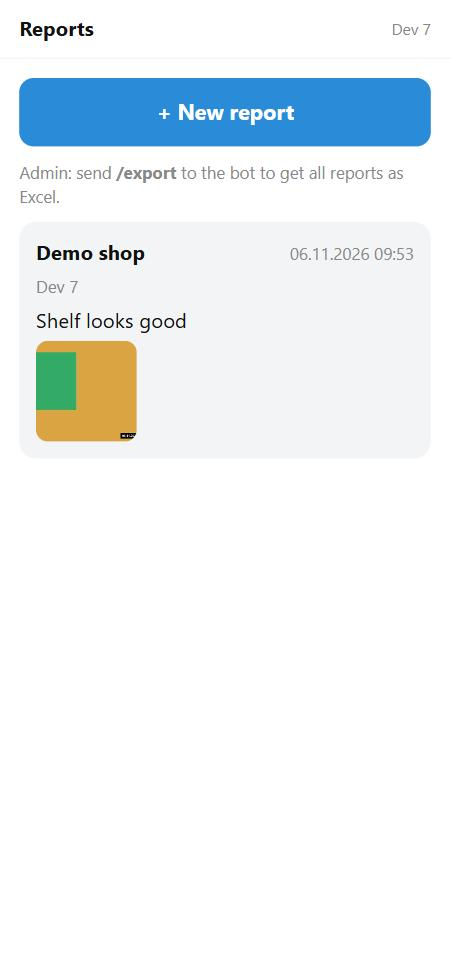

# tg-miniapp-starter

A Telegram bot + Telegram Mini App starter that runs on **cheap shared hosting**:
no Docker, no root, no systemd, no open ports. If your hosting gives you SSH, a
domain with SSL, cron and Python 3.11, this runs there.

[O'zbekcha](docs/README.uz.md) · [Русский](docs/README.ru.md)



## What you get

- **One process** runs both the bot (aiogram 3, long polling) and the web part (FastAPI).
- **Mini App login without passwords**: `initData` from Telegram is verified with your bot token
  ([app/auth.py](app/auth.py)).
- **Camera photos**: the app opens the phone camera directly, shrinks photos before upload,
  and the server stamps the date and time in the corner ([app/media.py](app/media.py)).
- **Private photo links**: photos live outside the web root and every link is HMAC-signed.
- **Excel export** with a live `SUM` formula and embedded photo thumbnails
  ([app/excel.py](app/excel.py)); admins get it with `/export` in the bot.
- **Shared-hosting scripts** ([server/](server/)): install, start/stop with a watchdog that
  cannot start a second copy, daily backups, an Apache `.htaccess` reverse proxy.
- Light/dark theme from Telegram, no build step, no frontend framework.
- Tests for the parts that are easy to get wrong ([tests/](tests/)).

The demo app is a simple "photo report" (title, note, photos). Replace it with your own idea:
the plumbing around it is the reusable part.

## Run it locally

```bash
python -m venv .venv
. .venv/bin/activate            # Windows: .venv\Scripts\activate
pip install -r requirements-dev.txt
cp .env.example .env            # set DEV_MODE=1 for local testing
uvicorn app.main:app --port 8000
```

Open <http://localhost:8000/?dev=1> in a browser. `?dev=<id>` works only with `DEV_MODE=1`.
Put your own Telegram id into `ADMIN_IDS` to see the admin view. Run the tests with `pytest`.

## Deploy on shared hosting (ISPmanager, cPanel, CloudLinux…)

1. **Create the bot** with [@BotFather](https://t.me/BotFather) and copy the token.
2. **Upload the code** to a folder outside your domain's web root, for example `~/myapp`.
3. **Configure**:
   ```bash
   cd ~/myapp
   cp .env.example .env                       # BOT_TOKEN, PUBLIC_URL, ADMIN_IDS
   cp server/paths.conf.example server/paths.conf   # DATA_ROOT, PYTHON, PORT
   sh server/install.sh
   sh server/manage.sh start
   curl -s http://127.0.0.1:3090/health       # {"ok":true}
   ```
4. **Proxy the domain to the app**: copy [server/htaccess.example](server/htaccess.example)
   to your domain's web root as `.htaccess` and set your port. Issue the SSL certificate
   in your hosting panel (Telegram requires HTTPS for Mini Apps).
5. **Cron**: add the lines from [server/crontab.example](server/crontab.example)
   (start on reboot, watchdog every 5 minutes, backup at 02:30).
6. Open your bot in Telegram and send `/start`.

Commands: `sh server/manage.sh start|stop|restart|status|log`.

## Pitfalls this starter already handles

| Symptom | Cause | Where it is handled |
|---|---|---|
| `/health` works but `/` gives 404 | Apache rewrites `/` to `/index.php` | `DirectoryIndex disabled` in `htaccess.example` |
| SSL renewal stops working | the proxy also catches `/.well-known/` | excluded in `htaccess.example` |
| Watchdog starts a new copy every 5 min, log full of "address already in use" | stale PID file after a reboot | `manage.sh` finds the process in `/proc` by its command line |
| Two bot copies, Telegram returns `409 Conflict` | old process still polling | same `/proc` check before every start |
| Users still see the old version after an update | Telegram's browser caches JS/CSS | `Cache-Control: no-cache` on static files |
| Photos come out sideways | rotation stored in EXIF | `ImageOps.exif_transpose` |
| Form error shows as raw JSON / a bare 422 | FastAPI treats an empty required field as missing | optional `Form("")` plus a clear check in the endpoint |
| Phone "back" closes the screen instead of the photo | full-screen viewer not in history | viewer is pushed to `history` |
| Home quota fills up | pip cache and temp files in `~` | `install.sh` sends them to `DATA_ROOT` |
| Your app talks to another account's service | `127.0.0.1` ports can be shared between accounts on one machine | pick an unusual `PORT`, check `/proc/net/tcp` first |

## Project layout

```
app/        FastAPI app, bot, auth, photos, Excel
webapp/     the Mini App (plain HTML/CSS/JS)
server/     install, manage, backup, .htaccess and cron examples
tests/      pytest
```

## License

[MIT](LICENSE). Issues and pull requests are welcome.
